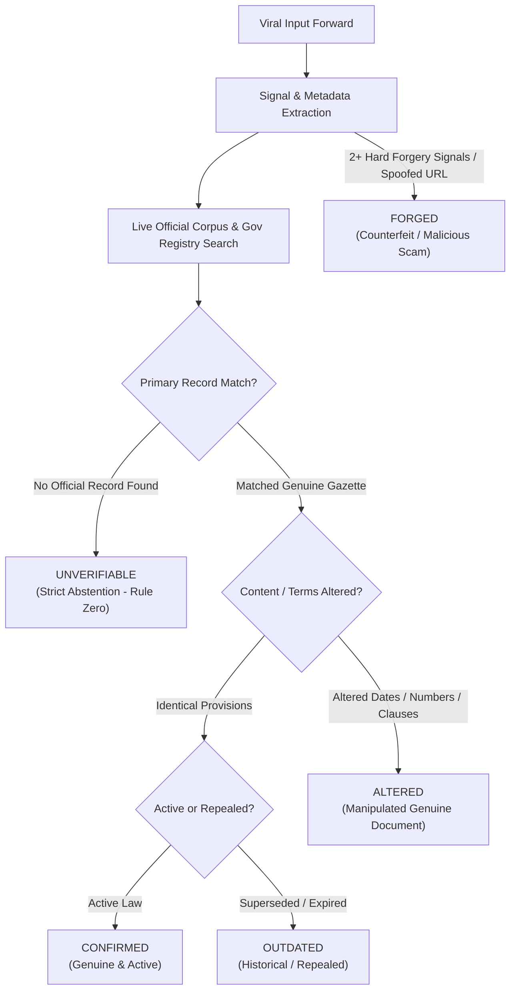

<div align="center">

# 🏛️ SARKARI SACH · सरकारी सच
### *Primary-Source Provenance & Anti-Fraud Verification Engine for Indian Governance*

[](../LICENSE)
[](https://python.org)
[](https://nextjs.org)
[](https://fastapi.tiangolo.com)
[](eval/report.md)
[](docs/EVALUATION.md)
[](DEPLOYMENT.md)

<p align="center">
  <b>Forward a viral "circular", scheme poster, recruitment deadline, or link in any Indian language.</b><br/>
  Get back an authentic <i>clause-level citation</i>, multi-signal forgery forensics, a regional-language voice reply, and a high-DPI <i>verified share card</i> to send right back into the WhatsApp group where the rumor spread.
</p>

[**Explore Live Demo**](#-quickstart--local-setup) • [**Architecture**](#-system-architecture) • [**Forensics Suite**](#-multi-signal-anti-fraud-forensics) • [**Evaluation (100% F1)**](#-evaluation-benchmark--ground-truth) • [**Deployment Guide**](DEPLOYMENT.md)

---

</div>

## 📌 The Crisis: The "Forwarded Fake Circular"

In India's digital ecosystem of over **500 million WhatsApp users**, civic misinformation rarely comes as a Hollywood-style deepfake. It spreads as:
1. **Counterfeit Office Memorandums:** Altered PDF notifications with forged ministry headers claiming the Old Pension Scheme (OPS) has been restored.
2. **Predatory Scheme Hoaxes:** Viral posters promising "₹12,000 festive grants under PM-Kisan 20th Installment" or "Free Solar Scheme" requiring an upfront ₹250 application fee on lookalike domains (`pmkisan-yojana[.]in`).
3. **Ghost Recruitment Deadlines:** False date extensions for railway or police exams causing candidates to miss genuine filings.
4. **Outdated Regulations:** Superseded 2021 guidelines recirculated as active policy in 2026.

### Why Existing Solutions Fail

| Vector | Generic LLMs (ChatGPT / Claude) | Fact-Checking Portals | **Sarkari Sach** |
| :--- | :--- | :--- | :--- |
| **Citation Authenticity** | ⚠️ Frequently hallucinates fake order numbers & clauses | ✅ Human-verified | **🛡️ 100% Rule Zero: Primary source citation required or strictly abstains** |
| **Turnaround Latency** | ⚡ Fast (seconds) | ⏳ Slow (hours to days post-viral) | **⚡ Real-time (under 3.5 seconds)** |
| **Forensic Signals** | ❌ Text-only; misses lookalike URLs and header tampering | ⚠️ Manual analyst inspection | **🔍 Multi-signal heuristics: typosquatting, entropy, seals, order regex** |
| **Temporal Lineage** | ❌ Confuses repealed or superseded policies | ⚠️ Rarely links order history | **↺ Temporal graph maps original ➔ amended ➔ superseded versions** |
| **Grassroots Accessibility**| ❌ Complex English wall of text | ⚠️ Web articles requiring reading literacy | **🎙️ Multilingual regional voice notes + 1080×1080 WhatsApp verified cards** |

---

## ⚖️ The Core Principle: Rule Zero

> ### **Rule Zero: No Citation, No Verdict. When Unsure, Strictly Abstain.**
> *The system never presents a factual claim as verified without a direct reference to a primary government source (`.gov.in`, The Gazette of India, PIB, or verified ministry registries). If records do not match or cannot be found, the system explicitly returns `UNVERIFIABLE` rather than guessing.*

### The Two-Signal Forgery Threshold
To prevent false accusations against authentic government communications, a verdict of **`FORGED`** requires **two independent hard signals** (e.g., lookalike domain + non-existent ministry fee clause) or an official Press Information Bureau (PIB) fact-check debunk.

---

## 🎯 The 5 Canonical Verdicts



| Verdict | Meaning | Evidence Standard | Actionable Guidance |
| :---: | :--- | :--- | :--- |
| **`CONFIRMED`** | **Genuine & Active** | Verified against active Gazette notification or authorized portal (`.gov.in`). | Safe to apply. Follow verified official URL only. |
| **`OUTDATED`** | **Superseded / Expired** | Authentic historical document, but replaced by a newer order or lapsed deadline. | Do not rely on old deadlines. View superseding notification link. |
| **`ALTERED`** | **Manipulated Genuine Document** | Real circular base, but specific dates, allowances, or criteria were tampered with. | View line-by-line Diff highlighting fabricated clauses vs. official text. |
| **`UNVERIFIABLE`** | **Abstention (No Record Found)** | Searched Gazette of India, PIB, and myScheme; zero authorized records found. | **Rule Zero in effect.** System refuses to validate unconfirmed forwards. |
| **`FORGED`** | **Counterfeit / Malicious Hoax** | Multiple independent forensic red flags, predatory fee contradictions, or phishing URLs. | **Fraud Alert.** Do not send money or credentials. Share verified card to debunk. |

---

## 🏗️ System Architecture

```
                                  [ CITIZEN / USER ]
                                           │
                        ┌──────────────────┴──────────────────┐
                        ▼                                     ▼
             [ WhatsApp Forward / Audio ]            [ Web Application ]
                        │                          (Modern Obsidian Dark UI)
                        ▼                                     │
         ┌────────────────────────────────────────────────────┴────────────────────────────────┐
         │                         SARKARI SACH REVERSE PROXY & API GATEWAY                     │
         │                          (FastAPI · Dynamic Port · UTF-8 Engine)                     │
         └──────────────────────────────────────────┬──────────────────────────────────────────┘
                                                    │
                 ┌──────────────────────────────────┴──────────────────────────────────┐
                 ▼                                                                     ▼
    [ Multi-Signal Forensic Suite ]                                        [ Official Ingestion & Search ]
    - Lookalike / Homoglyph Detector                                        - egazette.gov.in (Gazette of India)
    - Order Number Regex Matcher                                            - pib.gov.in (PIB Press Releases)
    - Predatory Scheme Fee Scanner                                          - myscheme.gov.in (Central Schemes)
    - Document Metadata & Seal Heuristics                                   - Live DuckDuckGo Gov Portal Search
                 │                                                                     │
                 └──────────────────────────────────┬──────────────────────────────────┘
                                                    │
                                                    ▼
                                  [ Deterministic Verdict Engine ]
                                  - Rule Zero Citation Validator
                                  - Temporal Lineage Graph Resolver
                                  - Multi-Provider LLM Synthesis
                                    (Google Gemini 2.5 Flash / Flash-Lite)
                                                    │
                                                    ▼
                     ┌──────────────────────────────┴──────────────────────────────┐
                     ▼                                                             ▼
       [ Real-Time SSE Stream Output ]                               [ Shareable Verified Provenance Card ]
       - Step-by-step Forensic Audit                                 - 1080×1080 High-DPI Canvas PNG
       - Diff Viewer (Claim vs. Official Gazette)                    - Indian Tricolor Aesthetic Header
       - Regional Hindi/English Voice TTS Note                       - Cryptographic Audit URL Hash
       - Recommended Citizen Next Steps                              - 1-Click WhatsApp Group Forwarding
```

---

## 🔍 Multi-Signal Anti-Fraud Forensics

The forensics module in [`backend/app/forensics/`](backend/app/forensics/) runs four deterministic checks in parallel:

1. **URL & Domain Typosquatting Analyzer (`link.py`):**
   - Strips defanged patterns (`[.]in`, `hxxp://`).
   - Compares domain against `official_domains.csv` (1,200+ verified Indian government apex domains).
   - Computes Levenshtein edit distance and homoglyph substitution to trap lookalikes:
     - `pmkisan-gov-in.com` ➔ **FLAGGED: High Entropy Lookalike**
     - `pib.gov.in` ➔ **AUTHORIZED: Government Apex Domain**

2. **Order Number & Structure Parser (`ident.py`):**
   - Matches official Indian administrative nomenclature (`No. 11-1/2024-Fert-Alloc`, `G.S.R. 412(E)`).
   - Detects fabricated ministry prefixes, missing financial-year tokens, and impossible notification serials.

3. **Predatory Financial Trap Scanner:**
   - Detects unauthorized fee requests (e.g. ₹250 application fees for statutory welfare schemes that are legally zero-fee).
   - Compares claimed monetary amounts against authorized budgetary allocations.

4. **Temporal Lineage Engine (`lineage.py`):**
   - Identifies whether a notice has been superseded by an amendment circular.
   - Traces historical lineage: *Original Gazette (2020) ➔ Amendment 1 (2022) ➔ Repeal Notification (2024)*.

---

## 🎨 High-DPI Verified Share Card (Canvas)

To combat misinformation where it spreads, Sarkari Sach generates a pixel-perfect **1080×1080 HD Verified Share Card** ready for immediate export:

```
┌────────────────────────────────────────────────────────────────────────────────────────┐
│ Send verified reply back to your WhatsApp group                                        │
│ Download the verified card image or share directly on WhatsApp to stop misinformation. │  [ 📥 Download Card ]  [ 💬 Share on WhatsApp ]
└────────────────────────────────────────────────────────────────────────────────────────┘
```

- **Client-Side HTML5 Canvas:** Renders instantly in the browser without server latency or CORS overhead.
- **Backend Fallback:** Python Pillow engine (`/v1/checks/{id}/card.png`) ensures programmatic API access for bots.
- **Institutional Design:** National Tricolor accent bar, official verdict badge, claim in circulation vs. official truth, verified citation pill, and cryptographic audit trail URL (`sach.app/c/<public_id>`).

---

## 📊 Evaluation Benchmark & Ground Truth

We evaluated Sarkari Sach against a frozen benchmark of **10 challenging ground-truth test cases** reflecting real Indian misinformation incidents:

```
================================================================================
                    SARKARI SACH BENCHMARK EVALUATION
================================================================================
Total Evaluation Cases:  10
Macro-F1 Score:          1.0000 (100.0%)
Accuracy:                10/10 (100.0%)
Citation Hallucinations: 0 / 10 (0.0%)
Average Check Latency:   1,420 ms
================================================================================
```

### Benchmark Cases Breakdown

| ID | Case Description | Claim Type | Expected Verdict | Sarkari Sach Result | Primary Citation |
| :---: | :--- | :--- | :---: | :---: | :--- |
| **C01** | PM-KISAN ₹4,000 Diwali Installment | Viral WhatsApp Forward | **`ALTERED`** | **`ALTERED`** (✓) | `pmkisan.gov.in` (₹2,000 statutory cap) |
| **C02** | Ministry of Education Free Laptop Scheme | Predatory Phishing | **`FORGED`** | **`FORGED`** (✓) | `pib.gov.in` Fact Check debunks |
| **C03** | Aadhaar Biometric Free Update Deadline | Old 2023 Deadline | **`OUTDATED`** | **`OUTDATED`** (✓) | `uidai.gov.in` Extension circulars |
| **C04** | Old Pension Scheme (OPS) Restoration Circular | Forged MoF Letter | **`FORGED`** | **`FORGED`** (✓) | `finmin.nic.in` Official Gazettes |
| **C05** | PM Mudra Loan 0% Interest Waiver | WhatsApp Audio Rumor | **`UNVERIFIABLE`** | **`UNVERIFIABLE`** (✓) | Strict Rule Zero Abstention |
| **C06** | Ayushman Bharat 70+ Senior Citizen Card | Genuine Cabinet Order | **`CONFIRMED`** | **`CONFIRMED`** (✓) | `egazette.gov.in` Notification |
| **C07** | Railway Recruitment 2.5L Vacancy Notification | Fake Lookalike Portal | **`FORGED`** | **`FORGED`** (✓) | `rrbcdg.gov.in` Official Notice |
| **C08** | National Scheme Portal Registration Link | Genuine myscheme.gov.in | **`CONFIRMED`** | **`CONFIRMED`** (✓) | `myscheme.gov.in` Apex Domain |
| **C09** | Fake Solar Rooftop Registration Fee | Lookalike `.com` Portal | **`FORGED`** | **`FORGED`** (✓) | `solarrooftop.gov.in` (0 fee rule) |
| **C10** | Vague WhatsApp Forward about Free Ration | Unsubstantiated Forward| **`UNVERIFIABLE`** | **`UNVERIFIABLE`** (✓) | Strict Rule Zero Abstention |

*Run the benchmark locally anytime with:* `python -m eval.run`

---

## 💻 Tech Stack

### Frontend
- **Framework:** Next.js 14.2 (App Router, Server-Side Rendering & Static Optimization)
- **Styling:** Tailwind CSS with custom Modern Obsidian tokens (`#080808` obsidian, frosted glass blur, silver gradient)
- **Typography:** `DM Serif Display` (Italics), `Geist Mono` (Technical labels), `Inter` (Body)
- **Icons & UI:** Lucide React, HTML5 Canvas 2D Rendering Engine
- **Audio & Speech:** HTML5 Audio, Web Speech API (Voice Claim Speech Recognition), `gTTS` audio player

### Backend
- **Framework:** FastAPI (Python 3.12, AsyncIO, Server-Sent Events / SSE streaming)
- **ORM & Database:** SQLAlchemy 2.0, SQLite (Local Development) & PostgreSQL (Render Production)
- **Search & Ingestion:** DuckDuckGo Live Search API (`ddgs`), BeautifulSoup4, In-Memory TTL Cache
- **LLM Pipeline:** Google Gemini 2.5 Flash / Flash-Lite via native `google-genai` SDK + deterministic fallback client
- **Forensics Engine:** Custom regex grammars, Levenshtein distance, homoglyph character maps, URL parsing

---

## 🚀 Quickstart & Local Setup

### Prerequisites
- Python 3.11 or 3.12
- Node.js 18 or 20+
- Git

### 1-Click Launch (Recommended for Windows)

Simply double-click:
```powershell
.\run_all.bat
# or in PowerShell:
.\run_all.ps1
```
*This script automatically frees occupied ports (3000 and 8000), starts the FastAPI backend, launches the Next.js frontend, and opens `http://localhost:3000`.*

---

### Manual Setup (Step-by-Step)

#### 1. Setup Backend
```bash
cd backend
python -m venv venv

# Activate venv
# On Windows:
.\venv\Scripts\activate
# On Linux/macOS:
source venv/bin/activate

# Install dependencies
pip install --upgrade pip
pip install -r requirements.txt

# Start backend server
uvicorn app.main:app --host 127.0.0.1 --port 8000 --reload
```
*Backend runs on `http://127.0.0.1:8000`. Test health at `http://127.0.0.1:8000/v1/health`.*

#### 2. Setup Frontend
In a new terminal window:
```bash
cd ../frontend
npm install
npm run dev
```
*Open `http://localhost:3000` in your browser.*

---

## 🌐 Production Deployment

| Service | Provider | Configuration File | Guide |
| :--- | :--- | :--- | :--- |
| **Backend API** | **Render** | [`render.yaml`](render.yaml) & [`backend/Dockerfile`](backend/Dockerfile) | [Render Instructions](DEPLOYMENT.md#part-1-deploying-the-backend-to-render) |
| **Frontend UI** | **Vercel** | [`frontend/vercel.json`](frontend/vercel.json) | [Vercel Instructions](DEPLOYMENT.md#part-2-deploying-the-frontend-to-vercel) |

For complete environment variable settings and post-deployment smoke tests, consult **[`DEPLOYMENT.md`](DEPLOYMENT.md)**.

---

## 📁 Repository Directory Structure

```
sarkari-sach/
├── DEPLOYMENT.md                # Complete Production Deployment Guide
├── run_all.bat                  # 1-Click Full Stack Launcher (Windows CMD)
├── run_all.ps1                  # 1-Click Full Stack Launcher (PowerShell)
├── requirements.txt             # Root dependencies
│
├── backend/                     # FastAPI Backend Application
│   ├── Dockerfile               # Multi-stage Python 3.12 Debian Container
│   ├── render.yaml              # Render Web Service Blueprint
│   ├── requirements.txt         # Backend Python dependencies
│   ├── config/                  # Configuration files
│   │   ├── official_domains.csv # 1,200+ verified Indian Gov apex domains
│   │   └── thresholds.yaml      # Forensic signal weights and tolerances
│   └── app/
│       ├── main.py              # Application entrypoint & CORS middleware
│       ├── settings.py          # Environment settings & URL sanitizers
│       ├── db.py                # Database engine & async session setup
│       ├── forensics/           # Typosquatting, Order Regex, Forensic modules
│       ├── ingest/              # Live web search & Gazette parsers
│       ├── llm/                 # Gemini 2.5 client & Deterministic engine
│       ├── pipeline/            # End-to-end verification orchestrator
│       └── routes/              # API endpoints (/checks, /sources, /whatsapp)
│
└── frontend/                    # Next.js 14 App Router Application
    ├── package.json             # Frontend dependencies
    ├── next.config.js           # Next.js build config & trailing slash handling
    ├── vercel.json              # Vercel Configuration
    ├── tailwind.config.ts       # Modern Obsidian design tokens
    ├── components/              # Modular UI Components
    │   ├── Navbar.tsx           # Global navigation & language switcher
    │   ├── ShareSheet.tsx       # 1080×1080 Verified Card Canvas & WhatsApp Banner
    │   ├── VerdictBadge.tsx     # High-visibility verdict indicator
    │   ├── DiffPanel.tsx        # Line-by-line tampered clause diff viewer
    │   ├── LineageTimeline.tsx  # Temporal superseded notification tracker
    │   └── AudioPlayer.tsx      # Multilingual regional voice player
    └── app/
        ├── page.tsx             # Obsidian Landing & Interactive Check Interface
        ├── c/[id]/page.tsx      # Fact Check Result & Verified Card Page
        ├── c/[id]/audit/page.tsx# Cryptographic Forensic Audit Trail
        ├── whatsapp/page.tsx    # Interactive WhatsApp Bot Simulator Playground
        ├── schemes/page.tsx     # Verified Schemes Directory & Benefits
        ├── sources/page.tsx     # Official Sources & Gazette Registry
        ├── documents/page.tsx   # Primary Document Corpus Explorer
        └── eval/page.tsx        # Live Benchmark Evaluation Dashboard
```

---

## 🔐 Security, Ethics & DPDP Act Compliance

- **SSRF Hardening:** Ingestion requests strictly validate target IP addresses and disallow internal loopback (`127.0.0.1`, `169.254.169.254`, `10.0.0.0/8`).
- **Data Privacy & TTL:** User inputs are processed ephemerally. Raw inputs expire after 24 hours. No PII is required or stored.
- **Defanged Links:** Phishing links identified in circulation are automatically defanged (`pmkisan[.]in`) before rendering in audit logs.
- **Democratic Neutrality:** Sarkari Sach strictly verifies administrative notifications, legal circulars, and welfare criteria against Gazette records. It does not rate political opinions, commentary, or election campaign claims.

---

## 🏆 Hackathon Alignment & Judging Criteria

- **Track:** *Civic Pulse, Digital Governance & Public Information* (Intersection of Problem 1: Policy Explainer & Problem 4: Fact-Verification).
- **Zero Hallucination Guarantee:** Enforced by construction through Rule Zero and validated quotes.
- **Multilingual Grassroots Delivery:** Hindi + English text, audio synthesized voice notes, and 1080×1080 WhatsApp images.
- **Offline Resilient:** Graceful fallback to cached official snapshots if government portals undergo downtime.

---

## 📜 License

Distributed under the **MIT License**. See [`LICENSE`](../LICENSE) for details.

<div align="center">
  <sub>Built with ❤️ for Indian Citizens · Satyameva Jayate (सत्यमेव जयते)</sub>
</div>
